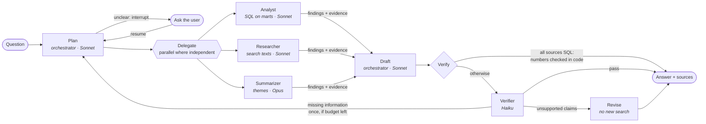
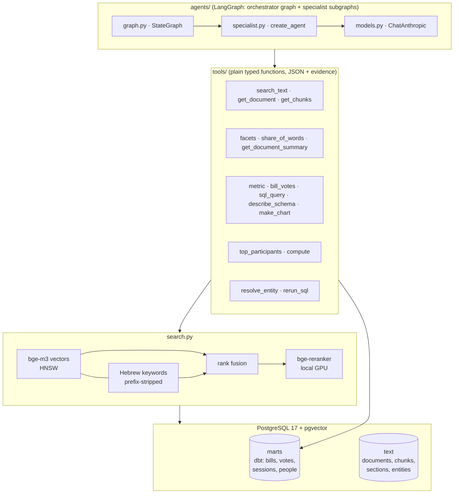

# How the Knesset analyst agent is built

One question goes through an **orchestrator graph** (LangGraph). The orchestrator plans,
hands tasks to **specialist agents**, writes a cited answer from their findings, and has it
**checked** before you see it. Every step is traced in Phoenix and Langfuse.

## The flow of one question

**Limits per question:** $0.50, 12 agent turns, 150 s. When one is hit, the answer says
what it has and that it stopped.

## The layers underneath

## The semantic layer

`src/knesset/semantic.yaml` says what the data means, once, for every agent:

| Part | What it holds | Who reads it |
|---|---|---|
| Glossary | question words → their meaning in the data ("עברו" = `is_passed`, "כמה זמן" = spoken words, "ארגונים שהופיעו" = attendance lists) | every agent |
| Entities | each table: key, columns, pitfalls (`fct_vote` has no `knesset_num`; committee ids change per Knesset) | analyst; text tables for researcher and summarizer |
| Metrics | governed counts and sums (`bills_passed`, `committee_sessions`, `queries`, `mk_votes`, `words_spoken`, `attendance`, …) with their dimensions | analyst, through the `metric` tool |
| Routes | which kind of question goes to which agent and tool | orchestrator, researcher |

`knesset/semantic.py` puts each agent's part into its prompt and compiles a metric with its
dimensions and filters into SQL; that SQL is the evidence the verifier (or the code check)
re-runs. SQL errors on a wrong column list the table's real columns, the closest match and the
layer's notes on that table.

Tools built on it: `metric`, `bill_votes` (every vote on a bill with its reading stage, and the
final vote by faction), `top_participants` (attendance lists), `compute` (arithmetic the code
checks). The verifier gets the passages the specialists already read, and is told when every
number was already checked in code.

## What runs where

| Part | Technology |
|---|---|
| Orchestrator graph | **LangGraph** `StateGraph`: start → plan → dispatch ⇉ specialists → draft → verify → revise / finish |
| Specialists | **LangChain `create_agent`** subgraphs: their tools, a strict output schema (`ProviderStrategy`), a model-call limit middleware |
| Models | **`ChatAnthropic`** (`agents/models.py`) with effort and server-side refusal fallback (Opus/Sonnet); any LangChain chat model plugs in through the factory in the runtime context |
| Models (`src/knesset/agents/agents.yaml`) | Orchestrator: Claude Sonnet 5.5 · Analyst, researcher, summarizer, verifier: Haiku 5.5 (eval matrix, 25 Nov 2026) |
| Contract | `AgentTask` → `AgentResult` (pydantic, JSON) through `AgentClient` — in process now, A2A in Phase 8 |
| Tools | Plain Python functions (`tools/`), each returning JSON with an `evidence` list; `langchain-core` builds their schemas |
| Database | PostgreSQL 17 + pgvector (Docker), read-only role `agent_ro` for agents |
| Structured data | dbt models in schema `marts`, from the Knesset OData API |
| Text | Word protocols → chunks by speaker turn; sections and attendance lists from the markup |
| Local models (Mac GPU) | bge-m3 (embeddings), bge-reranker-v2-m3 (reranking), DictaBERT-NER (entities) |
| Observability | OpenTelemetry → **Phoenix** (local) and **Langfuse Cloud**; OpenInference traces every Claude call; structlog JSON logs |
| Services (`docker-compose.yml`) | db, phoenix, app, ui, scheduler |
| CLI | `knesset ask` (streams steps, asks back, `--thread` for follow-ups), `knesset traces`, `knesset search` |
| Studio | `langgraph.json` → `uv run --with "langgraph-cli[inmem]" langgraph dev` opens the graph in LangGraph Studio |

## LangGraph features used

| Feature | Where |
|---|---|
| `Send` fan-out | `dispatch` sends every ready task to `specialist` in parallel; dependent tasks wait for the next round |
| Subgraphs | each specialist is a `create_agent` graph; its tool calls stream to the CLI (`subgraphs=True`) |
| `interrupt()` / `Command(resume=…)` | `clarify` pauses an unclear question; the CLI prompts and resumes the same thread |
| `Command(goto=…)` | `verify` routes to finish, revise or a re-plan |
| Checkpointer | `PostgresSaver` (schema `ops`) keeps each thread: follow-up questions see the earlier turns |
| Store | `PostgresStore` remembers entities resolved for a user, across threads |
| Runtime context | budget and model factory per run (`Context`), not in the state |
| `RetryPolicy` | plan, draft and revise retry transient API errors |
| Streaming | `updates` per node + `custom` events (agent started/done, cost) |

## Where things live

| What | Where |
|---|---|
| **System prompts** | `src/knesset/agents/prompts/*.md` — `common.md` (shared rules) + one per agent: `orchestrator.md`, `draft.md`, `analyst.md` (13 question → SQL examples), `researcher.md`, `summarizer.md`, `verifier.md`. Versioned with the code. |
| Graph and routing | `src/knesset/agents/graph.py` |
| Models, cost callback | `src/knesset/agents/models.py` |
| Budget and limits | `src/knesset/agents/llm.py` |
| Specialists and evidence checks | `src/knesset/agents/specialist.py` |
| Tools per agent | `src/knesset/tools/lc.py` (`AGENT_TOOLS`) |
| **Semantic layer** | `src/knesset/semantic.yaml` (glossary, entities, metrics, routes); `knesset/semantic.py` |
| Models and effort | `src/knesset/agents/agents.yaml` |
| Limits | `.env` (`AGENT_MAX_COST_USD`, `AGENT_MAX_STEPS`, `AGENT_TIMEOUT_S`) |

## Safeguards against wrong answers

- A finding may cite only chunks, documents or SQL that its own tools returned; invented ids
  are dropped, and evidence links come from the tool results, not from the model.
- Counts cite the exact SQL they ran, so the verifier can re-run them.
- SQL-only answers are checked in code: every number must appear in the query results.
- The verifier re-reads cited chunks and re-runs cited SQL; unsupported claims are removed
  or qualified, and the answer says what was changed.
